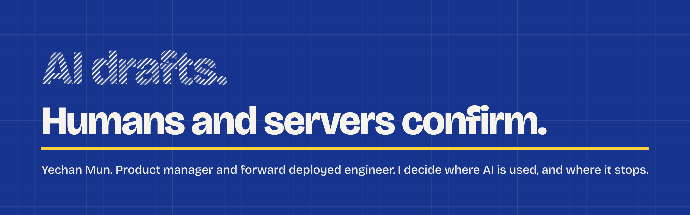

## Yechan Mun — Product Manager & Forward Deployed Engineer

I go to the site, count what is actually broken, build the smallest thing that survives there, and hand it over.

**The rule that repeats across everything below: AI drafts. Humans and servers confirm.**
Every AI feature I ship has a fallback, and every irreversible action is decided by a server or a person, never by a model.

**[LinkedIn](https://www.linkedin.com/in/munyechan11/)** · First-year undergraduate, Handong Global University · Vice President, IMC Technology Management Society

---

### At a glance

| Number | What it counts |
| --- | --- |
| **~900 people** | A client widened my safety-training pilot from the group registered at the start to its plant's full workforce. Its safety team reports about 97% completion. That is the client's count, and a different denominator from the 104 workers I counted at the start |
| **355 works · 300+ participants** | A citizen contest hosted by Korea's Ministry of the Interior and Safety ran on a platform I built as the team's only developer |
| **118,000+ views** | The same contest's Instagram, which I ran alone for four weeks (22 posts, 256 followers) |
| **2,656 tests** | Event-driven quant trading engine, solo. Paper mode only (2,654 passing on a clean re-run, Sep 2026) |
| **937 tests** | Evidence-based credentialing system, all passing |
| **2nd place, twice** | Local AI Makers Lab final demo day (2nd of 12 teams) and Glocal Business AI Capstone. Both are team awards |

---

### Why most repositories here are private

Several of these products have real users: a client's factory safety team, a care-service center, two pilot stores, and a public contest's entrants and judges. Their repositories hold client data models, partner terms, entrant records and credentials, so they stay private until each owner agrees otherwise.

**Everything below is live and clickable instead.** If you need to read code for an evaluation, ask me and I will arrange access to a specific repository.

---

### What I have shipped

**Multilingual Frontline Safety Platform** — Product Manager & sole developer
*Live: [aimake-tbm.onrender.com](https://aimake-tbm.onrender.com) · Android/iOS app in pilot since 27 Jul 2026*

On site I counted 103 of 104 registered workers as untrained, a 1% completion rate. Competing tools stopped at "translate and deliver", so I reframed the product to *verify comprehension*: you pass a quiz in your own language or you are not marked as trained.

* 3-layer localization for 11 languages: base dictionary → 98 pre-translated domain terms → runtime AI translation
* Offline-first. A cache miss returns a network error, never "no training today". That single false display is what turns into an incident
* Fallbacks on all 12 AI-backed features, so the product works with no API key at all
* Deploy aborts and keeps the previous version on any destructive schema change

Adoption: the client has since widened the pilot to the plant's full workforce, about 900 people, and its safety team reports about 97% completion. The 1% and the 97% do not share a denominator (the group registered at the start versus the whole plant after the widening), and the 97% is the client's count, not mine.
Our team placed 2nd of 12 teams at the program's final demo day.

`NestJS` `Prisma` `PostgreSQL` `Capacitor` `PWA` — 143 API routes · 29 data models · 72 tests · 254 commits, all single-author

---

**Contest Platform — 2026 Ocean Ecosystem Change Contest** — the student team's only developer
*Live: [ocean-contest-2026.vercel.app](https://ocean-contest-2026.vercel.app) · Sep – Nov 2026 · results announced 16 Nov 2026*

A citizen contest on how Korea's seas are changing: hosted by the Ministry of the Interior and Safety, organized by the Gyeongbuk Citizens Foundation, in cooperation with Handong Global University. One platform carried it from entry to results. Another teammate was the project manager; the contest rules and judging criteria came from the team, the foundation and our professor.

* Official site in Korean and English with a public gallery, entry forms in both languages, and a dozen Apps Script automations behind them
* Nothing went public on its own: every entry passed an operator check, and no entrant's name or contact details were published
* A private judging site where three judges scored every work independently and saw the work, not the person. Names, contacts, schools and bonus flags were hidden, and 36 images whose metadata carried names, serial numbers or GPS were swapped for stripped copies
* Scoring runs in exact fractions and fingerprints its inputs and outputs with SHA-256, so two operators can run it separately and compare
* One incident: on the last day of judging, image storage hit its transfer cap and 283 images went blank. I rebuilt them from the public site's metadata-free copies

I also ran the contest's Instagram alone for four weeks, paid ads included (22 posts, 256 followers, 118,000+ views), and built the promotion dashboard, a short entry link and a "how did you hear about us" form question behind it.

Result: 300+ participants · 355 works judged (102 videos, 168 photos, 85 posters) · 3 judges · 19 awards

`HTML/CSS/JavaScript, no build step` `Vercel Functions` `Supabase` `Google Apps Script` — about 18,000 lines · 92 commits

---

**Event-Driven Quant Trading Engine** — solo
*[source](https://github.com/munyechan11-cell/invest) · Aug 2026 – present · paper mode only*

Backtest, paper trading and live execution share one pipeline: universe → alpha → portfolio construction → risk → execution. It replaced an earlier short-term investing assistant in the same repository.

* A multi-agent LLM research desk is one alpha model among several. It has no authority over position sizing or execution, and the risk layer can only shrink or veto its targets
* Live trading requires three explicit switches and sits behind per-order caps, an orders-per-minute limit and daily loss limits
* Backtests are built not to flatter themselves: next-bar fills, costs on by default, deflated Sharpe, purged walk-forward
* Three places where the screen and reality disagreed during paper runs, each fixed with a regression test

No returns are reported here: there is no verified performance record, and backtests describe the past.

`Python` `FastAPI` `SQLite` `WebSocket` `Docker` `GitHub Actions` — about 38K lines of engine code · 2,656 tests · 145 commits (Sep 2026)

---

**Evidence-Based Credentialing System** — Product Owner & lead developer
*Live: [skillprint-student.vercel.app](https://skillprint-student.vercel.app)*

Turning a research finding (employers want narrative context, not digital badges) into a working system.

* Deliberately **no LLM**. This document is used in hiring, so it runs on a rule-based narrative engine with a source field on every sentence, traceable back to the exact input
* Found a forgery vector in my own build (approval badges could be faked through an unsigned link) and added Web Crypto ECDSA P-256 signatures, while stating in the UI that a signature proves integrity, not identity
* A permanent 5-axis self-verification tab, so anyone can check the output

937 tests passing · rubric of 6 competencies × 4 levels

---

**Care-Service Operations + Assistant Chatbot** — sole developer
*Live: [dolbom-sangdam.vercel.app](https://dolbom-sangdam.vercel.app)*

* Scored 3 architectures (54/55/41) before committing, and chose the one that survives network and API outages
* Built risk detection as a 33-term rule lexicon rather than an LLM, and wrote *the judgment is human* into the code. I claim high sensitivity and low precision, not accuracy
* Anonymized by default: records stored under codes only, raw utterances excluded from the UI and from backups

---

**Retail Operations Cloud (POS · CRM · ERP · AI)** — founder, sole developer
*Live: [theta-sepia.vercel.app](https://theta-sepia.vercel.app) · [source](https://github.com/munyechan11-cell/gyeol)*

* Re-defined the anonymous QR visitor as a customer identifier, so returning customers are recognized with zero signup drop-off
* Automatic RFM classification into 6 grades, driving tiered messaging
* An approval gate with an audit log: AI writes the draft, the server confirms the booking
* HMAC-SHA256 verification on payment webhooks; a 4-stage route guard (login → role → attendance → grade)

Validated in 2 pilot stores on a pay-after-results model I negotiated with the owner directly.

---

**Local ESG Gamification Platform** — sole developer
*Live: [esg-sul.vercel.app](https://esg-sul.vercel.app)*

A 5-step mission (intro → quiz → GPS geofence → AI receipt verification → limited reward) that completes with **zero operator intervention**. 50+ active users; 3 partner cafés signed in person.

---

**Restaurant Operations ERP — AI/OCR domain** *(team project; my scope is the AI/OCR domain)*
Released on Google Play. I designed 3 pipelines that pull daily and hourly revenue out of receipt and POS screenshots, so an owner records sales from one photo. I treated the output schema and the verification layer as the real problem, not the prompt: a health-check endpoint, a 422 reproduction test that isolated a UOM field type mismatch, and a verify script.

---

### Prototypes built against a clock

**LocalLink** — one-day capstone, team award (2nd place)
*Live: [hanbae-omega.vercel.app](https://hanbae-omega.vercel.app)*
A joint-export idea: shoppers abroad commit first, and small regional food makers ship together once a "voyage" fills. I merged the team's three ideas into one flow and built and deployed the 29-screen web prototype. Prototype only: payments, login and shipping are simulated, every business in it is fictional, and the product photos are AI-generated.

**Young Duck** — two-day regional ideathon in Yeongdeok (participation)
*Live: [young-duck.vercel.app](https://young-duck.vercel.app)*
A travel service for foreign independent travelers that turns a day trip into an overnight stay. I built the web prototype (a PWA in four languages) for the team's pitch. Prototype only: sign-in is mocked, the in-app guide is rule-based for now, and the demand figures in the pitch are assumptions, not measurements.

---

### Awards and writing

* Excellence Award, 2nd of 12 teams — Local AI Makers Lab 2026-1 final demo day (team) · selected as the outstanding member within my team
* 2nd Place (Excellence Award) — Glocal Business AI Capstone 2026, Handong Global University (team)
* POSCO Vision Scholarship — POSCO TJ Park Foundation
* Second author, 2026 domestic conference paper on synthetic persona simulation for B2B decision making (IPACT)

---

### How I work

* The workaround people already use (the spreadsheet, the group chat, the paper log) is the real spec
* I name what a product cannot do before I demo what it can
* I do not report a pilot as a success until the adoption number comes back
* AI coding agents are my implementation tool, and I say so up front. What I own is the domain model, the permission structure, the failure and fallback scenarios, and the criteria for stopping a release

---

### Stack

| Area | What I use |
| --- | --- |
| Product | On-site discovery, baseline counts, JTBD, RICE / ICE / MoSCoW, leading and lagging metrics, kill criteria |
| AI / LLM | Schema-forced outputs, tool-use orchestration, a fallback on every AI route, rule engines where an LLM should not decide |
| Backend and data | `TypeScript` `Python` `NestJS` `FastAPI` `Prisma` `PostgreSQL` `Supabase` `Firebase` `SQLite` `Google Apps Script` |
| Frontend and delivery | `React` `Next.js` `Vite` `Tailwind` `PWA` `Capacitor` |
| Trust and security | Approval gates, audit logs, row-level security, HMAC and ECDSA signing, blind-review data handling, security reviews of my own builds |
| Growth and operations | Instagram content, paid ads, launch operations, field sales (10 cold visits, 2 MOUs) |

Last updated: November 2026
